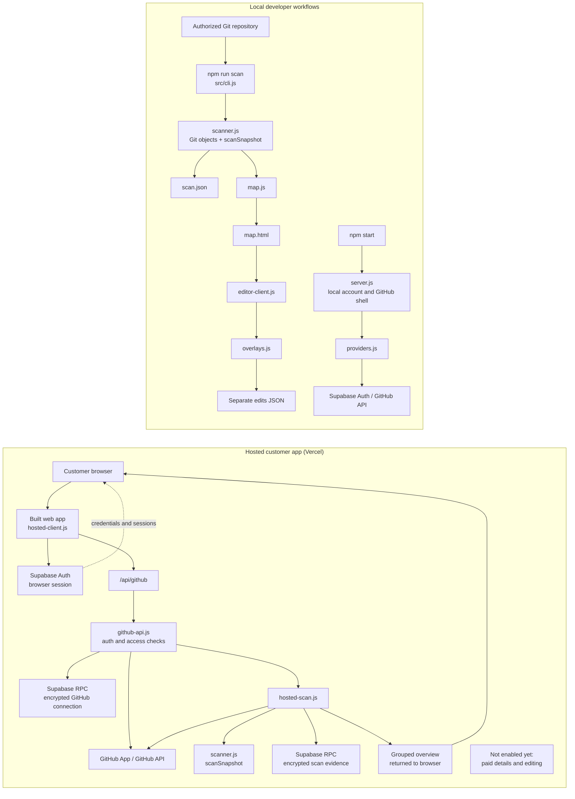

# Repo Made Clear — accounts, GitHub connection, and local scanner

Local development only. The existing Site is untouched. This includes extraction and the first human-editing workflow, not the hosted product. No accounts, GitHub credentials, payment service or paid infrastructure are needed.

## Architecture overview



The hosted app and local developer tools are separate. The hosted scanner reuses the source-analysis logic but returns a grouped preview; the local CLI produces protected full findings and a standalone editable map. Neither source findings nor human edits are mixed with one another.

## Customer account and GitHub entry flow

Run `npm start` and open http://localhost:4174. This new customer shell is separate from the offline developer editor. It implements the managed-auth and GitHub App adapters, but live registration and authorization need configuration. See [ACCOUNTS_SETUP.md](ACCOUNTS_SETUP.md). Without configuration it reports setup is needed; it does not create demo accounts or pretend a scan ran.

Both component details and editing require payment, reconfirmed by the user. No billing or hosted customer scan is enabled yet. Twenty tests now pass, including seven new account/GitHub boundary tests. Local browser rendering and auth-view switching were verified; external email/OAuth flows remain unverified until setup.

## Open in VS Code

Open this workspace's `app` folder. With Node 22+ and Git installed:

```sh
npm ci --ignore-scripts
npm test
node scripts/scan-self.js
npm run scan -- /absolute/path/to/authorized-git-repository main owner/repository
```

The command prints a `map.html` path. Open that file in a browser. `scan.json` beside it contains structured findings. Both include protected details and are local developer artifacts: never expose these files as the free customer preview.

`scan-self.js` copies this application's real source into a temporary Git repository, commits a clearly labeled local snapshot and scans it. It prints the retained snapshot path for checking evidence. This is not an external customer validation or fabricated example. The source snapshot is temporary and may be removed by the operating system.

## Supported boundary

Committed `.js`, `.jsx`, `.mjs`, `.cjs`, `.ts`, `.tsx` source; explicit ES imports/re-exports and literal dynamic imports. Relative source references resolve exact paths, extensionless paths, index files and JS-to-TS extensions. Bare imports are package references, not confirmed services. CommonJS calls, computed imports and unresolved relative references are counted as gaps. Alias configurations, Next.js routes, database/API calls, infrastructure, runtime topology and business impact are not yet supported. This narrower slice is an implementation recommendation within the proposed JS/TS MVP.

The scanner reads Git objects, never executes scanned source or installs its dependencies. Only normal committed files are considered; symlinks, environment files, secret-like paths, tests and common generated directories are excluded. No source snippets or arbitrary literal values are saved or sent to AI. This is not a general secret detector; file paths and package names are retained as evidence, so security review is required before customer code intake.

Caps: 2,000 tree entries, 20 MB repository blobs, 500 KB per supported file, 15 seconds and 10,000 connections. No AI calls or tokens. Runtime and bytes are recorded. A declared but unused package does not generate a node. Findings have repository, branch, commit, scan time, typed references and exact source line ranges. Explanations are deterministic and describe only observed references.

Outputs retain the first findings for an identical commit/context instead of overwriting them. This currently avoids output replacement, not repeat parsing; early scan caching and frequency enforcement belong before a hosted scanning endpoint. Human edits and positions live in an independent overlay document; the original scan findings remain unchanged.

## Edit the map and carry context into a rescan

1. Open the generated `map.html` in your browser and enter your name for edit attribution.
2. Select a component or connection. Add an explanation and design rationale; source findings remain separately visible.
3. Add a component or connection under **Add human context**. Added components and reconnected arrows are human-supplied, never scanner-verified.
4. Drag components to move them. Keyboard users can focus a component and use arrow keys.
5. Choose **Save edits file** to save a separate JSON document. Browser storage is a convenience only; its availability and sharing between local files vary.
6. Scan a newer commit. Open its map, choose **Load edits file**, and load the saved JSON. Loading replaces the current working edits, so save those first.
7. Review changed or missing source evidence. Context and saved positions survive. Missing components/connections remain in the review list rather than appearing as newly detected facts. You cannot mark missing evidence reviewed; retain the note and add a human component/connection if appropriate.

Each human edit records its author and update time. Source-bound edits also record the evidence fingerprint and commit they were reviewed against. A line-number shift alone does not invalidate a connection note. Changed import content, resolved destination, source-file contents, or scanner version flags relevant context. Layout positions are preserved independently. Human names are self-reported locally, not authenticated identities.

The edit document is scoped to repository label and branch, validated on import, capped at 1,000 entries per collection and 2 MB per imported file, and cannot add fabricated source evidence. Repository labels must remain consistent across rescans. This is local data separation, not tenant isolation or paid entitlement. Legacy version 0.1 scans lack the new fingerprints; generate a version 0.2 scan before using this workflow.

## Validation and next gate

Thirteen automated tests pass. They cover evidence correctness, unused packages, secret-file exclusions, unsupported patterns, resource limits, parent-repository fallback rejection, generated-script escaping and CSP integrity, immutable scan findings, stable connections after line shifts, changed destinations, overlay preservation, missing evidence, and invalid/cross-context edit imports. Run `npm test`.

Actual source verification: five supported application files and twelve references. No third-party source was executed. The user-provided `brickware-web/repomadeclear` GitHub repository became publicly accessible but had no commits; the provided local folder was empty. Neither has been modified or populated by this implementation.

Browser visual/interaction QA is outstanding: the browser tool's URL policy blocked opening the local HTML file. Automated model and generated-script tests passed, but do not substitute for an end-to-end browser check. Check note saving, drag/keyboard movement, file save/load, reload persistence, connection corrections, and review actions in a browser before considering the local editing milestone fully accepted.

Next: perform browser QA and validate extraction with an authorized representative repository containing code. The three-repository/owner review gate remains outstanding. Add route/integration patterns only with evidence tests. Early scan caching, frequency enforcement, accounts, GitHub App access, tenant isolation, server-side paid entitlements and webhook replay handling remain later work. No deployment is authorized or implied by this local artifact.
